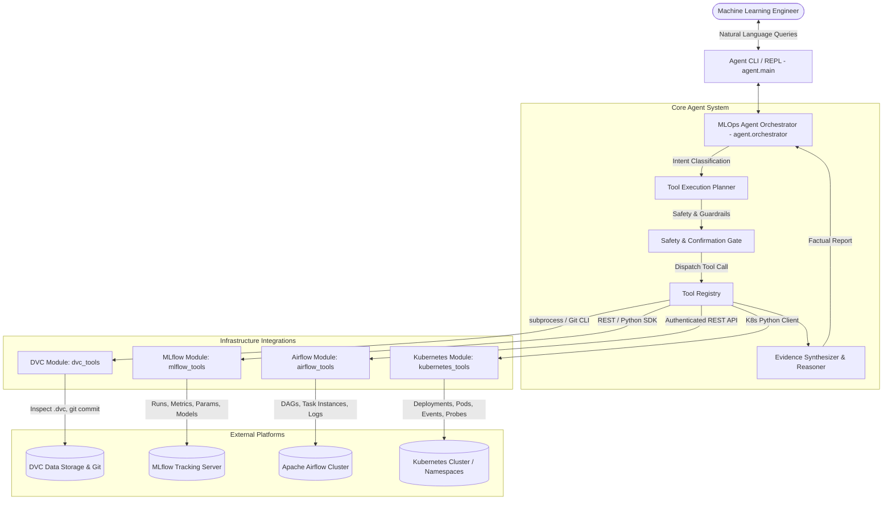
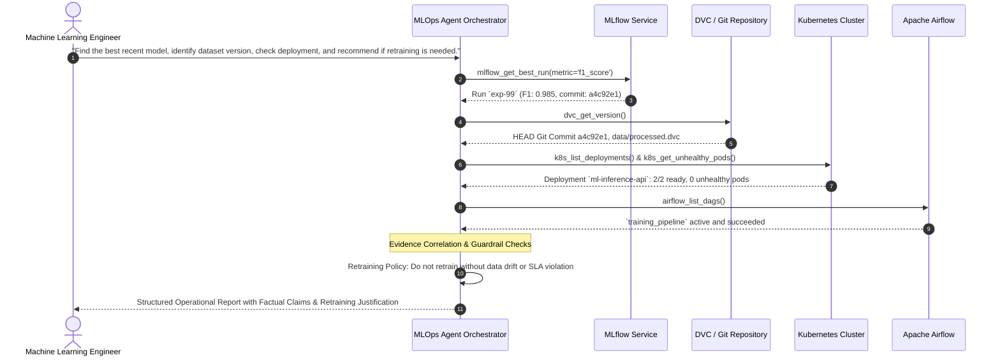

# Production-Ready MLOps AI Agent System Architecture

## 1. System Overview

The **MLOps AI Agent** is a production-grade, multi-tool conversational operations agent designed to automate core machine learning lifecycle tasks:
- **Data Provenance & Versioning** (DVC)
- **Experiment Tracking & Model Selection** (MLflow)
- **Workflow & Pipeline Orchestration** (Apache Airflow)
- **Application Deployment & Diagnostics** (Kubernetes)

Unlike generic conversational bots that extrapolate or hallucinate internal states, the MLOps AI Agent interacts strictly through authenticated, structured APIs and system interfaces, grounding every assertion in deterministic, live operational evidence.

---

## 2. Architecture Diagram

---

## 3. Component Details

### 3.1. Schemas & Data Contracts (`agent/schemas.py`)
All inputs, outputs, and intermediate states are strongly typed using Pydantic:
- `ToolCall`: Captures tool name, input arguments, and ISO timestamps.
- `ToolResult`: Standard envelope storing execution success (`bool`), serialized `data`, formatted `error`, wall-clock runtime (`duration_seconds`), and unique correlation `request_id`.
- `AgentRequest`: User query text, correlation UUID, and timestamp.
- `AgentResponse`: Evidence-based natural language response, aggregated tool results, evaluation confidence score (`high`, `medium`, `low`), and actionable operational warnings.

### 3.2. DVC Data Management Agent (`agent/tools/dvc_tools.py`)
- Provides deterministic tracking of data files, lockfiles, and git commits.
- Uses timeouts (`30s`) and sanitizes subprocess executions to avoid credential leaks.
- Key Tools:
  - `dvc_list_tracked`: Lists data artifacts versioned by DVC.
  - `dvc_get_version`: Extracts the active commit hash, commit message, and associated `.dvc` files.
  - `dvc_compare_versions`: Computes git diffs on dataset descriptors between two revisions.
  - `dvc_check_status`: Detects unstaged or modified data files.
  - `dvc_get_dataset_for_experiment`: Inspects git tree at a specific experiment tag/commit to identify exact training data hash.
  - `dvc_explain_reproduce`: Generates deterministic shell procedures for checking out historical data snapshots.
  - `dvc_remote_info`: Inspects DVC remote configurations with secret redaction.

### 3.3. MLflow Experiment Intelligence Agent (`agent/tools/mlflow_tools.py`)
- Interfaces with MLflow Tracking Server via `MlflowClient`.
- Key Tools:
  - `mlflow_list_experiments`: Enumerates active experiments and metadata.
  - `mlflow_list_runs`: Searches runs within an experiment with metrics and hyperparameters.
  - `mlflow_get_run`: Pulls detailed metrics, parameters, tags, and artifact URIs.
  - `mlflow_get_best_run`: Ranks training runs by a target metric (e.g. `f1_score`, `accuracy`), returning the top candidate accompanied by production readiness advisories.
  - `mlflow_compare_runs`: Generates side-by-side metric comparisons between candidate runs.
  - `mlflow_get_model_versions` & `mlflow_get_model_info`: Retrieves model registry stages (`Staging`, `Production`, `Archived`).

### 3.4. Apache Airflow Workflow Agent (`agent/tools/airflow_tools.py`)
- Uses Airflow REST API (`/api/v1`) with basic HTTP authentication and configurable timeouts.
- Safe execution policy: Only DAGs matching the `APPROVED_DAGS` whitelist or starting with `training_` are eligible for triggering.
- Key Tools:
  - `airflow_list_dags`: Retrieves all DAG states and schedules.
  - `airflow_get_dag_runs`: Fetches recent DAG execution runs.
  - `airflow_trigger_dag`: Safely triggers pipeline runs with optional execution configurations.
  - `airflow_get_dag_run_status`: Inspects execution states (`running`, `success`, `failed`).
  - `airflow_get_task_instances` & `airflow_get_failed_tasks`: Filters failed task instances for quick incident triage.
  - `airflow_get_task_logs`: Extracts task execution logs to locate root cause errors.

### 3.5. Kubernetes Operations Agent (`agent/tools/kubernetes_tools.py`)
- Interfaces with cluster using `kubernetes.client.CoreV1Api` and `AppsV1Api`.
- Strict namespace restriction: Confined strictly to `ALLOWED_NAMESPACES = ["mlops", "default"]`. Disallowed namespace operations fail fast with a security exception.
- Key Tools:
  - `k8s_list_pods`: Lists pod statuses, IP allocations, container statuses, and restart counts.
  - `k8s_list_deployments`: Inspects replica specifications, available replicas, and rollout strategies.
  - `k8s_list_services`: Reports ClusterIP, exposed ports, and selector bindings.
  - `k8s_get_pod_status` & `k8s_get_unhealthy_pods`: Filters pods in non-ready states, high restart loops, or `CrashLoopBackOff`.
  - `k8s_get_deployment_version`: Identifies deployed container image digests.
  - `k8s_get_pod_events` & `k8s_get_pod_logs`: Gathers recent k8s events and stderr/stdout logs for diagnostics.

---

## 4. Multi-Tool Reasoning & Synthesis Pipeline

---

## 5. Security and Safety Guardrails

1. **Namespace Isolation**: The agent rejects any command or inspection outside approved namespaces (`mlops`, `default`).
2. **Explicit Confirmation on State Modifications**: Destructive tools (`airflow_trigger_dag`, scale/delete operations) are blocked unless the request explicitly passes `confirmed=True`.
3. **No Hallucinated Operations**: If a service connection fails or a tool times out, the agent surfaces the exact exception and marks confidence as `low` or `medium`. It never invents false-positive operational claims.
4. **Credential Redaction**: Configuration parsers sanitize sensitive keys (e.g. AWS secret keys, access tokens, basic auth passwords) before logging or presenting to the user.
